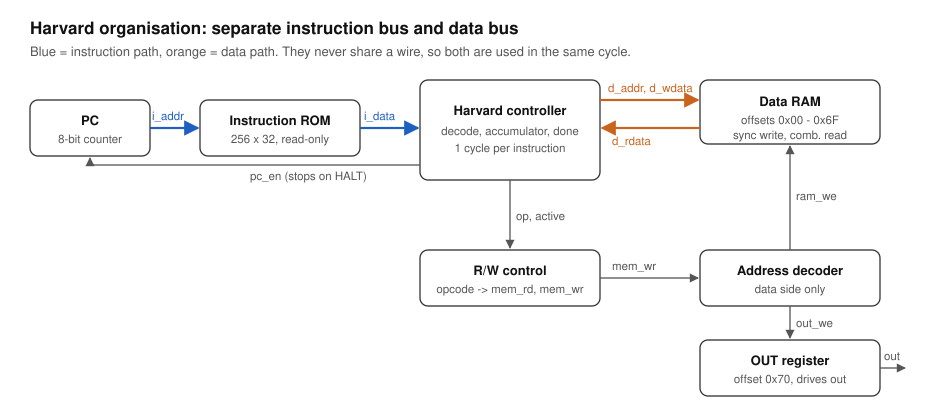
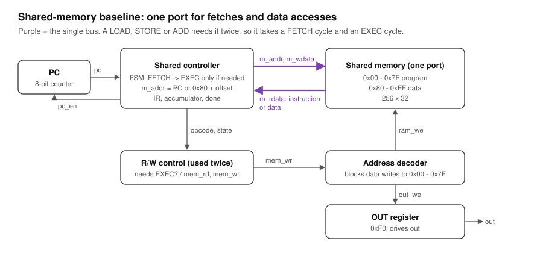

# Instruction and Data Memory Hierarchy

**Modern Computer Architecture (MCA) · Project 9 · Team Lethals**

A simplified Harvard-style memory organisation in Verilog, with separate instruction and data paths, compared against a shared-memory (von Neumann-style) baseline that runs the same programs.

## Team Lethals

| Member | GitHub |
|---|---|
| Aadit Vachher | [@aadit-vachher](https://github.com/aadit-vachher) |
| Kush Puri | [@kushpuri07](https://github.com/kushpuri07) |
| Aabir Sarkar | [@aabirsarkar-sde](https://github.com/aabirsarkar-sde) |
| Kushagra Maheshwari | [@kush11-m](https://github.com/kush11-m) |
| Kavya Katal | [@KatalKavya96](https://github.com/KatalKavya96) |

## Project objective

Implement a simplified Harvard-style memory organisation with separate instruction and data paths, and analyse its behaviour against a shared-memory organisation.

Planned modules: Program Counter, Instruction Memory, Data Memory, Address Decoder, Read/Write Control, a simple controller, and a shared-memory baseline.

## Architecture

| Harvard design | Shared-memory baseline |
|---|---|
|  |  |

- **Harvard:** instruction ROM and data RAM on separate buses. Every instruction takes 1 cycle: the fetch and
  the data access happen in the same clock period.
- **Shared baseline:** one memory, one port. Every instruction is fetched in one cycle; only LOAD, STORE and ADD
  need a second (EXEC) cycle on the same port.
- Both run the same programs with the same instruction set, address map and cycle-counting rule, so any
  difference comes from the memory organisation alone.

Instruction word `{opcode[31:28], imm[27:8], addr[7:0]}`: NOP (0), LOAD (1), STORE (2), LDI (3), ADD (4), HALT (F).
Details for every module: [docs/MODULES.md](docs/MODULES.md).

## Preliminary results

| Program | Instructions N | Data accesses M | Harvard cycles | Shared cycles | Speed-up |
|---|---|---|---|---|---|
| P1 block copy | 18 | 13 | 18 | 31 | 1.72x |
| P2 array sum | 16 | 11 | 16 | 27 | 1.69x |
| P3 compute-heavy | 16 | 4 | 16 | 20 | 1.25x |

Measured counts equal the prediction N (Harvard) and N + M (shared) exactly; the speed-up is 1 + M/N, not a
fixed 2x. Full results and synthesis cell counts: [docs/results.md](docs/results.md).

## Repository layout

```
rtl/common/    pc, instr_rom, data_ram, out_reg, rw_control
rtl/harvard/   harvard_decoder, harvard_ctrl, harvard_top
rtl/shared/    shared_decoder, shared_mem, shared_ctrl, shared_top
programs/      p1_copy.hex, p2_sum.hex, p3_compute.hex (commented)
tb/            tb_units.v, tb_harvard.v, tb_shared.v
sim/           run_all.sh, GTKWave views (*.gtkw)
synth/         Yosys scripts (generic cell counts)
docs/          block diagrams, module walkthrough, results
report/        IEEE report (Phase I)
VIDEO.md       demo video link
```

## How to run

Requires Icarus Verilog (`brew install icarus-verilog`) and, for waveforms, GTKWave.

```sh
sh sim/run_all.sh          # unit tests + both designs, prints PASS/FAIL and cycle counts
gtkwave sim/harvard.gtkw   # Harvard waveform with signals pre-selected
gtkwave sim/shared.gtkw    # shared baseline waveform
yosys -s synth/synth_harvard.ys   # optional: generic synthesis cell counts
```

## Status

Phase I: RTL, directed tests, cycle comparison and block diagrams done. IEEE report and demo video in progress.
Phase II: synchronous-read memories, FPGA timing (Fmax) on a chosen target, wider program mix.
